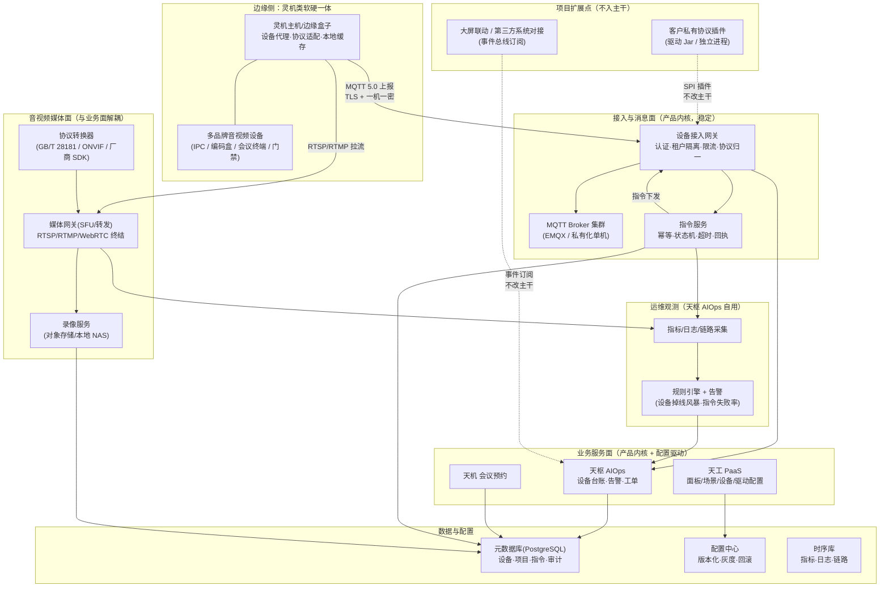

# 01 现状诊断与目标架构

> 深挖侧声明：**我的强项在设备接入 / 指令语义 / 交付工程化一侧**，音视频媒体面按"不犯错的边界设计"处理：
> 我给出协议取舍判据、媒体面与业务面的边界、以及私有化内网拓扑的坑位，但不会在面试中把媒体面
> 说成我的一手经验（见 `02` 的 2.B 开头声明）。

## 1.1 诊断：最可能的 8 个架构 / 交付风险

| # | 风险 | 症状 → 对销售 / 交付的伤害 |
|---|------|---------------------------|
| 1 | **定制分叉失控** | 同一需求在 A 项目写在主干、B 项目复制一份改一下，半年后主干无法升级 → 新项目从 v1.3 起，交付周期从 6 周涨到 4 个月，报价只能靠人肉兜。 |
| 2 | **南向设备协议烟囱** | 每接一个品牌新增一套私有解析/协议分支，代码里出现 `if (vendor == "X")` → 兼容性问题总在客户现场爆发，且"接一个新品牌"永远排不进迭代。 |
| 3 | **指令语义缺失（受理当成功）** | 下发接口同步返回 200 就是"成功"，设备实际没执行时上层无感知 → 政企场景出现"平台显示已关闭，设备仍在开会"的信任崩塌事故，直接触发验收纠纷。 |
| 4 | **媒体面与业务面耦合** | 预览/回放逻辑写在业务服务里，媒体转发依赖业务进程存活 → 业务发版即断流，客户现场"升级一次就黑屏一次"。 |
| 5 | **私有化升级不可靠** | 现场升级靠人肉脚本、数据库手工改表、没有回滚 → 每次升级都是一次赌博，出问题只能回退整机快照，运维成本与客户怨气双高。 |
| 6 | **多租户/多项目隔离缺失** | 指令下发只按 device_id 寻址，没有租户与项目边界 → 跨项目误控设备，属于政企客户的红线（安全事故而非功能缺陷）。 |
| 7 | **可观测性不足** | 只有应用日志，没有设备在线率、指令成功率/时延、媒体流健康度等业务指标 → 故障靠客户投诉发现，AIOps 产品自己却没有 AIOps 能力，售前演示讲不圆。 |
| 8 | **配置与代码未分离（国产化/环境适配靠分支）** | 换国产 OS/数据库要发版 → 私有化现场"临时适配"变成项目加班，客户环境与主干永久分叉。 |

## 1.2 目标逻辑架构（12–18 个月）

**边界要点（面试最容易被追问的三条）**

1. **媒体面 ≠ 业务面**：媒体面（`M1/M2/M3`）只负责"把像素搬过来并保证不断"，它不认识业务对象；
   业务面（`B1/B2`）只处理"谁的哪块屏、什么权限、是否录像"，媒体面通过**媒体会话资源**与业务解耦。
   好处：媒体进程独立发版与扩缩容，业务发版不会打断正在进行的会议。
2. **接入面 ≠ 业务面**：设备只与接入网关对话（`A2`），业务服务**不直连 MQTT**。
   业务下指令 → 指令服务 → 网关 → 设备；这条链路上的每一次状态变化都有 `command_id` 可追。
3. **项目扩展点 = 插件 + 配置 + 事件订阅**：任何客户专属逻辑只能以这三种形态存在，且都**不改变主干接口**。

## 1.3 演进分期

| 阶段 | 业务目标（可卖 / 可交付） | 架构必做 | **明确不做** | 人力假设 |
|------|--------------------------|----------|--------------|---------|
| **P0（0–90 天）** | 让"标准化产品"能独立卖：设备台账、指令下发、告警、私有化交付包可用 | ① 指令语义统一（幂等 + 状态机 + 超时 + 显式失败），参考 `coding/` 实现；② 契约先行：设备接入统一 MQTT 主题与 JSON 载荷（含 `tenant_id/project_id`）；③ 私有化离线包 + 版本迁移脚本 + 一键回滚；④ 最小可观测：设备在线率 / 指令成功率 / 指令时延 / 流健康度 4 个指标 + 告警 | ✘ 不做微服务拆分（保持模块化单体）；✘ 不引入工作流引擎；✘ 不做多活/双机房；✘ 不自研协议栈；✘ 不做智能诊断大模型 | 1 名架构师（我）+ 2 名后端 + 1 名嵌入式 + 0.5 名测试；每周固定 1 天"架构时间" |
| **P1（3–9 月）** | 让"私有化定制"可复制：非标设备与大屏联动不再改主干；媒体面与业务面解耦 | ① 南向协议网关（多品牌协议适配下沉为插件/驱动，独立进程，带契约测试）；② 媒体网关独立成进程（会话资源与业务解耦，支持 200 路预览压测基线）；③ 配置中心化（面板/场景/联动走配置与模板）；④ 事件总线（对外提供订阅接口，客户系统对接不改主干） | ✘ 不做统一设备模型"大一统"建模（先支持 3 类高频设备，其余走插件）；✘ 不做国密全链路改造（先做可选编译/部署包）；✘ 不做自研音视频协议；✘ 不做跨地域多活 | 2 名后端 + 1 名嵌入式 + 1 名媒体/音视频（可外协 1 人）+ 0.5 测试 + 售前 0.5 |
| **P2（9–18 月）** | 让"自研产品销售爬坡"成立：标准版可复制部署、单客户运维成本下降、AIOps 能力可售 | ① 标准化率度量看板并纳入版本节奏（见 `03`）；② 私有化/公有云同源部署（同一镜像 + 配置差异），版本升级通道打通；③ 告警风暴治理（限流 + 抑制 + 根因聚合），AIOps 卖点可演示；④ 选型做国产化矩阵（麒麟/统信 + 国产 CPU/数据库）并纳入 CI | ✘ 不做多活与异地灾备（除非有政企合同硬要求）；✘ 不做自研协议栈全家桶；✘ 不做全量中台化（含数仓/DMP/低代码平台）；✘ 不做多云统一编排 | 3 名后端 + 1 名嵌入式 + 1 名媒体 + 1 名测试 + 1 名运维（兼）+ 售前 1 |

**关于"明确不做"的说明**（评分点）：以上"不做"不是保守，而是**与销售爬坡直接相关**——
每引入一个新平台形态（多活、中台、工作流、自研协议），团队就要多一套"人也要会、版本也要升、演示也要做"的负担，
在 8–15 人规模下这会直接吃掉一个迭代周期的三分之一。P2 之所以敢开国密与国产化，是因为那时我们有一个
**可复制的交付基线**；现在做，只会把交付团队拖进"一个客户一种环境"的老路。
