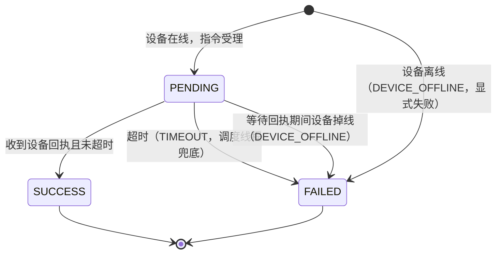

# 02 关键链路详设

> 深挖侧声明：设备接入 / 指令语义是我的强项，2.A 按「接口 + 主题 + 状态机 + 容量假设」级别写透；
> 2.B 我给出**按场景取舍的判据**与媒体面/业务面边界，不假装是一手音视频经验，涉及国密/国产化只点到方法层。

---

## 2.A 设备大规模接入与指令链路

### A.1 接入模型：为什么是 MQTT 5.0（而不是 HTTP / gRPC / 自研 TCP）

| 候选 | 判断 |
|------|------|
| **MQTT 5.0（选中）** | ① 设备侧内存占用小（报文最小可到 40B 级），适合"灵机"这类算力受限的边缘设备与第三方盒子；② 长连接 + QoS1 天然贴合"少量下行、大量上行"的遥测模型；③ Broker 成熟（EMQX 社区版即可私有化单机部署），运维成本低；④ 主题天然承载多租户/多项目隔离，ACL 可在 Broker 侧做第一道防线；⑤ 支持 **Shared Subscription / 集群 / 会话保持**，横向扩容不需要业务改协议。 |
| HTTP 轮询 | 设备 5000 路、轮询周期 10s → 500 QPS 恒定长连接与电量浪费；下行时延不可控（依赖下一次轮询），"关灯"这类指令做不到秒级。 |
| gRPC 双向流 | 性能最好，但设备侧 JVM/Go SDK 体积与内存对边缘盒子不友好；弱网重连语义要自己写；私有化现场 TLS/证书分发成本高于 MQTT。 |
| 自研 TCP 长连接 | 收益只有一个（省 3% 带宽），代价是心跳、重连、粘包、多路复用全自研——**明确不做**。 |

**结论**：南向统一 MQTT 5.0；边缘代理（灵机）负责把多品牌私有协议**收敛**成 MQTT 上报，把 MQTT 指令**翻译**成私有协议。
「一个设备 = 一个 MQTT 身份 + 一份设备档案（协议类型 + 参数）」，这样接新品牌是**加一个驱动**，不是**加一个分支**。

### A.2 设备身份、鉴权、租户 / 项目隔离

- **一机一密**：设备出厂烧录 `device_id` + `client_id`（=`tenant_id/project_id/device_id`）+ 独立证书或
  `username/password + PSK`。证书由"天枢设备注册中心"签发，支持吊销与轮换。
- **认证链**：MQTT 连接 → 接入网关校验签名与证书（拉取 CRL/吊销列表，缓存 60s）→ 校验 `client_id` 前缀中的
  `tenant_id/project_id` 与连接声明一致 → 设备档案查库，确认该设备属于该项目。
- **私有化可简化的部分**（要说清）：私有化现场若无法接 CA，**降级方案**是
  「网关侧预共享密钥 + 设备白名单 + 内网 IP 段绑定」，密钥在离线包安装时生成并随设备档案导入；
  代价是**必须在内网隔离该网段**，因此合同里要写明"设备网段不得与办公网互通"，并做端口与源地址审计。
- **隔离三件套**：
  1. **连接级**：ACL 决定设备只能发布 `up/{tenant}/{project}/{device}/#`、订阅 `down/{tenant}/{project}/{device}/#`；
  2. **数据级**：所有下行指令与上报载荷强制带 `tenant_id/project_id`，服务端以**会话上下文**为准做二次校验
     （不信任载荷里自称的租户字段，防止伪造）；
  3. **资源级**：单项目设备数、单租户在线连接数、指令 QPS 均有配额，超限触发限流与告警（政企红线：绝不跨项目寻址）。

### A.3 主题、载荷与接口

**主题设计**（`{env}` 在私有化为 `prod`，公有云为 `tenant`）：

```
up/{tenant}/{project}/{device}/telemetry     上报（QoS0，容忍丢失）
up/{tenant}/{project}/{device}/event         事件/告警（QoS1）
up/{tenant}/{project}/{device}/ack            指令回执（QoS1）
down/{tenant}/{project}/{device}/command      指令下发（QoS1）
down/{tenant}/{project}/{device}/config       配置下发（QoS1）
```

**上行载荷（统一 JSON Schema，schema 版本随载荷走）**：

```json
{
  "schema": "telemetry/v1",
  "ts": 1792637925946,
  "seq": 10231,
  "tenant_id": "t-1001",
  "project_id": "p-88",
  "device_id": "dev-smoke-1",
  "metrics": { "cpu": 12.5, "temp": 46 },
  "status": { "online": true, "firmware": "3.2.1" }
}
```

**指令下发接口**（对齐 `coding/` 中的实现，语义为「受理 ≠ 成功」）：

| 接口 | 方法 | 说明 | 返回 |
|------|------|------|------|
| `/commands` | POST | 下发指令；必填 `device_id/action/idempotency_key`，可选 `timeout_ms` | `202` + `command_id` + 当前 `status`（可能已是 `FAILED`） |
| `/commands/{command_id}` | GET | 查询指令状态 | `200` + `status/error/error_message` |
| `/devices/{device_id}/online` | PUT | 上下线（真实系统由设备连接状态驱动，此处为演示/运维手段） | `200` |

**指令状态机**（`coding/src/c2d/Command.java` / `CommandService.java` 已实现并单测）：

**指令状态机（ASCII 版）**

```text
  设备在线 · 下发受理                     设备离线 · 下发受理
         │                                     │
         ▼                                     ▼
    ┌──────────┐                          ┌──────────┐
    │ PENDING  │                          │  FAILED  │  错误码: DEVICE_OFFLINE
    └────┬─────┘                          └──────────┘
         │
         ├─ 收到设备回执且未超时 ──▶ ┌──────────┐
         │                          │ SUCCESS  │  终态
         │                          └──────────┘
         │
         ├─ 超过 deadline（超时） ──▶ ┌──────────┐
         │                          │  FAILED  │  错误码: TIMEOUT
         │                          └──────────┘
         │
         └─ 等待回执期间设备掉线 ──▶ ┌──────────┐
                                    │  FAILED  │  错误码: DEVICE_OFFLINE
                                    └──────────┘

  规则：① 超时判定优先于回执（宁可失败，也不误报成功）；② 终态不可逆；
        ③ 设备离线 = 显式失败，绝不"入队即成功"。
```

**Mermaid 源**（GitHub 或支持 Mermaid 的阅读器可直接渲染；上方 ASCII 版为通用兜底）



**幂等与重试**：
- **幂等键由调用方生成**（建议 `业务单号 + 动作 + 目标` 的哈希），服务端用
  `idempotency_key → command_id` 的**确定性映射**（`coding/` 中用 SHA-256 前 16 位十六进制），
  并用 `ConcurrentHashMap.computeIfAbsent` 保证"同键只创建一次"的原子性——**杜绝 check-then-act 竞态**。
- **同键不同参数**（同 key 但 device/action 不同）→ 返回 `409 idempotency_conflict`，**不静默复用**。
- **重试语义**：网络层重试由调用方用**同一幂等键**重试，服务端只会产生一条指令；
  服务端不对设备重复下发同一条指令（避免"重启执行两次"），只对**未回执**的指令在超时后置为 `FAILED`，
  需要重发由业务侧以**新的幂等键**显式重发，并带上 `retry_of` 关联原指令。
- **设备侧幂等**：设备固件按 `command_id` 去重（保留最近 N 条已处理 id），防止 QoS1 重复投递导致重复执行。

### A.4 弱网、批量上线、告警风暴下的保护

| 风险 | 手段 | 为什么选它 |
|------|------|-----------|
| 4G 弱网抖动 | 上行 QoS0 + 序列号 `seq` 补洞；下行 QoS1 + 指数退避重连（1s→2s→4s→…→60s 封顶，带抖动） | 上行数据可容忍丢（下一帧覆盖），下行不能丢；退避 + 抖动避免"重连风暴" |
| 批量上线（5000 台同时重连） | **分批唤醒 + 令牌桶限流**（每项目每分钟 N 台），Broker 侧限制单连接速率；客户端带随机 jitter | 设备集体重连会瞬间打满 Broker 连接与鉴权 CPU |
| 指令风暴 | 指令服务入口令牌桶（按租户/项目双维度配额）；MQTT 下行队列**有界**，超限返回 `429`/拒绝并计入 `cmd_rejected_total` | 宁可明确拒绝，不要把压力传导成"大量超时"这种无法定位的故障 |
| 告警风暴（设备批量掉线被当成 5000 条告警） | 告警在接入层先做**同源聚合**（同项目/同型号/同原因在 60s 窗口内聚合成 1 条），再做抑制与恢复通知 | 5000 条告警会把值班工程师淹掉，真正的首因被埋掉；这是 AIOps 产品的基本功 |
| 单设备上报洪水 | 单设备令牌桶（上报 QPS 上限）+ 服务端降采样（超限后按 1/N 采样并标记 `downsampled`） | 保护平台不被一台故障设备拖垮 |
| 服务过载 | 限流 → 降级（关闭非核心聚合/富媒体分析，保留告警与指令）→ 背压（MQTT 会话保持 + QoS 队列有界） | 降级顺序按"客户感知"排列：指令与告警 > 报表 > 统计 |

### A.5 "云端显示成功、设备未执行"的架构防线（5 道）

1. **语义防线**：下发接口只返回"受理"，成功与否由**设备回执**决定；没有回执就没有 `SUCCESS`。
   任何"超时即成功""入队即成功"的写法在 code review 中直接拒绝。
2. **状态机防线**：`PENDING` 只能由两条路径离开——收到回执 → `SUCCESS`；超时/掉线 → `FAILED`。
   终态不可逆，且超时优先级高于回执（宁可失败也不误报成功）。
3. **幂等防线**：同一幂等键只产生一条指令，杜绝"网络重试导致重复执行"这类事故的另一半。
4. **对账防线**：设备侧周期性上报"最近执行的 command_id 列表/执行结果摘要"，服务端与指令表做**差集对账**，
   发现"云端 SUCCESS 但设备无记录"或"设备执行了但云端无记录"，生成一致性告警（这是 AIOps 的真实抓手）。
5. **展示防线**：前端对 `PENDING` 必须显示"执行中"，对 `FAILED` 显示具体原因码，
   禁止把 `PENDING` 聚合成"操作成功"的 toast（很多"假成功"其实是前端做的）。

### A.6 容量级假设（自拟，需在评审中按实测修正）

| 指标 | 假设值 | 依据 |
|------|--------|------|
| 单客户设备规模 | 5000 台（智慧园区场景），单项目峰值 2000 台 | 销售侧常见标称 |
| 设备上报 | 每台 1 条/10s（约 150B）→ 5000 台 = 75 msg/s，峰值 3 倍突发 = 225 msg/s | 常规遥测 |
| 告警事件 | 峰值 50 msg/s（风暴时 2000 msg/s，由接入层聚合后降到 ~10 msg/s） | 现场经验 |
| 指令下行 | 峰值 200 条/s（批量场景），单条 ≤ 1KB | 大屏联动批量控制 |
| MQTT 连接 | 5000 并发长连接，单 Broker（EMQX）4C8G 可承载 3–5 万连接，私有化按 1 Broker/万连接规划 | 官方容量参考 + 保守折半 |
| 指令表 | 保留 30 天，按 200 条/s 峰值 × 1/20 实际均值估算 ≈ 5 亿行/年 → **按月分区 + 冷数据归档** | 成本约束 |
| 时延目标 | 指令下发→回执 P95 < 1s（正常网络），P99 < 3s | 客户感知 |
| 媒体 | 单节点 200 路 1080p@2Mbps 转码上限 ≈ 400Mbps（CPU 瓶颈），按 4 节点起步 | 保留 50% 余量 |

**数据库选型说明**：指令表既是"业务表"也是"审计表"，主库 PostgreSQL 分区表 + 对象存储归档；
不引入分库分表中间件（8 人团队运维成本不划算），靠分区与归档解决。

---

## 2.B 音视频媒体面

**声明**：我选的两个场景是 **① 运维远程监看（天枢 AIOps 的"看现场"）** 与 **② 会议预约的会议室预览（天机）**。
这两个场景对首帧、并发、断线重连的要求差别很大，正好能说明"按场景取舍"。

### B.1 典型场景

| 场景 | 诉求 | 规模假设 |
|------|------|---------|
| 运维远程监看 | 值班工程师点开任意通道，1–2s 出画面，能切多路（≤9 宫格），弱网下能降级 | 50 并发用户 × 平均 4 路 = 200 路并发 |
| 会议预约预览 | 预约会议室时看实时画面（用户不是专业人员，弱网移动端居多），要求"点开就有"，可容忍 2–3s 首帧 | 峰值 100 并发用户 × 1–2 路 |

### B.2 协议取舍（不罗列百科，给判据）

| 场景 | 选中 | 判据 |
|------|------|------|
| 运维远程监看（Web 客户端） | **WebRTC（SFU）** | 需要**超低延迟**与**双向**（对讲、PTZ 联动），H.264 硬编解码可复用设备/边缘的硬件能力；SFU 模式下延迟 200–500ms 可接受 |
| 会议预约预览（Web 客户端） | **WebRTC（SFU）**，不用 HLS | HLS 首屏 2–5s 且切片级延迟，对"点开就看"的会议预览体验太差；且 HLS 依赖 CDN/文件切片，不适合内网无 CDN 场景 |
| 设备 → 平台（上行） | **RTSP（拉流）为主 + RTMP 推流兜底** | 主流 IPC/编码盒都支持 RTSP 拉流，平台侧用 FFmpeg/GStreamer 拉流转封装为 WebRTC/RTMP；只有当设备厂商只给 RTMP 时才走推流模式（会多一跳、丢首帧） |
| 平台 → 第三方（大屏联动/转推） | **RTMP / SRT** | 大屏与第三方系统基本都吃 RTMP；SRT 用于弱网丢包场景（政务大屏常见） |
| 平台 → 客户自研系统 | **GB/T 28181 (SIP+RTP) 接入 / ONVIF 拉流** | 政企安防强需求；接入侧做成**协议转换器**（见 B.3），不让业务代码直接碰 SIP |

**一句话原则**：**延迟敏感的走 WebRTC/SFU，广播与转推走 RTMP/SRT，设备接入走 RTSP/GB28181，平台内部不转码（能透传就透传）**。

### B.3 媒体面与业务面的边界（关键设计）

```
业务面（天枢/天机）            媒体面（独立进程/独立部署）
┌────────────────┐            ┌──────────────────────────┐
│ 设备台账        │            │ 媒体网关(SFU)              │
│ 权限/工单/告警  │──创建会话──▶│  · 会话资源 MediaSession   │
└────────────────┘            │  · 订阅/推流/录制落盘        │
        ▲                     │  · 不认识业务对象            │
        └──事件（流异常/录制完成）└──────────────────────────┘
```

- **谁管信令**：业务面管"**谁可以看哪路**"（权限、审计、申请），媒体面管"**看的那一路怎么打通**"。
  业务面调用媒体面创建一个 `MediaSession`（含 `session_id`、通道、有效期、录制策略），拿到 `play_url`/信令后交给前端。
- **谁管流转发**：媒体面（SFU + 协议转换器），**业务面不做任何转发**。
- **录像落哪**：媒体面负责转码与落盘到对象存储/本地 NAS（统一格式 H.264 + A/V 同步），业务面只存**录像索引与元数据**
  （时间、设备、时长、事件标签），由业务面通过回调（事件订阅）更新索引。
- **权限如何控**：权限判定在业务面；媒体面拿到的是**已授权的 session_id 与短时效 token**，
  token 过期即断流（防止 URL 泄漏后长期盗看），媒体面不查业务库。
- **边界带来的收益**：① 媒体进程可独立发版/扩缩容，业务发版不影响正在进行的会议；
  ② 客户内网无公网时，媒体面可整体部署在客户侧（同一套代码，配置差异）。

### B.4 私有化客户内网：常见拓扑与坑

**典型拓扑**：客户内网 → 媒体面集群（2–4 节点）→ 边缘代理（灵机，走客户内网拉设备流）→ 品牌 IPC。
管理面（业务服务 + MQTT）同样在客户内网，运维通过堡垒机/VPN 访问。

**坑与对策**：

| 坑 | 现象 | 对策 |
|----|------|------|
| **NAT / 双网卡** | 媒体节点主动拉设备 RTSP 没问题，但设备回调或 WebRTC 回程走错网卡 | 媒体面**不依赖回调**（媒体是拉流 + SFU 推流，回程走 SFU 服务器地址），部署前用部署前检查脚本探测路由与出口 IP；双网卡环境显式配置 `media.advertise_ip` |
| **端口被限** | 客户安全策略只开 80/443，SFU 的 UDP 端口被封 → WebRTC 只能用 ICE-TCP/TURN 中继，延迟翻倍 | 部署参数化：支持 443/TCP 回退与 TURN 中继；**提前在售前确认端口策略**，把"UDP 端口段"写进交付前置条件（合同边界，见 `05`） |
| **无公网证书** | 客户内网自签证书，浏览器不信任 | 内网 CA 证书由客户 IT 签发并下发到终端；平台支持挂载证书，不做自签绕过 |
| **时间不同步** | 录像/回放时间错位、NTP 策略严格 | 平台与边缘统一 NTP；录像文件名带设备本地时间 + 平台时间双记录 |
| **带宽与 QoS 策略** | 客户出口限速，200 路预览把带宽打满，其他业务断网 | 媒体面支持**按会话限码率**与**并发上限**；平台侧做"预览并发配额"（按项目），超限排队而不是硬拉流；售前必须确认出口带宽（见 `05` 合同边界） |
| **国密/国产化** | 客户要求 SM2/SM4 传输加密 | **本期不做全链路国密**（明确写进"不做"）；做法是：媒体面在信令层可切换国密 TLS（用支持国密的反向代理/网闸），RTP 媒体流保持标准加密与内网隔离；信令与媒体**分离部署**（媒体流不过业务节点） |

### B.5 性能与体验：优先保证什么、牺牲什么

| 场景 | 优先保证 | 主动牺牲 |
|------|---------|---------|
| 运维远程监看 | ① 切换通道的**首帧时间**（≤2s，走预热连接池）；② 断线后 3s 内自动重连且**画面续上**；③ 弱网下先降分辨率再降帧率 | 牺牲：不做端到端加密的额外开销优化、不做多路同屏的 4K |
| 会议预约预览 | ① **"点开就有"**（客户端首包缓存 + 服务端常驻转码流，避免每次转码冷启动）；② 弱网下的**可降级**（WebRTC 不可用时回退 HLS 低清预览） | 牺牲：预览画质（默认 720p/1Mbps），需要看细节时再申请高清 |

**明确取舍的代价**：SFU 模式下服务端不转码（多路同屏时按路数线性增加带宽），这在 200 路并发的出口带宽上是主要成本，
因此我把它作为**售前必算项**而不是运行时问题（见 `05` 合同边界）。

### B.6 媒体面不做的事（与 `01` 的"明确不做"一致）

- 不自研音视频协议栈（用 SFU 现成实现 + FFmpeg/GStreamer 转封装）；
- 不做端到端加密（信令加密 + 媒体流加密在网关上做，弱网场景优先保证可播）；
- 不做大模型视频分析（另立 PoC，不进 P1/P2 主线；只在 P2 边缘侧做"可选事件检测"插件）。
