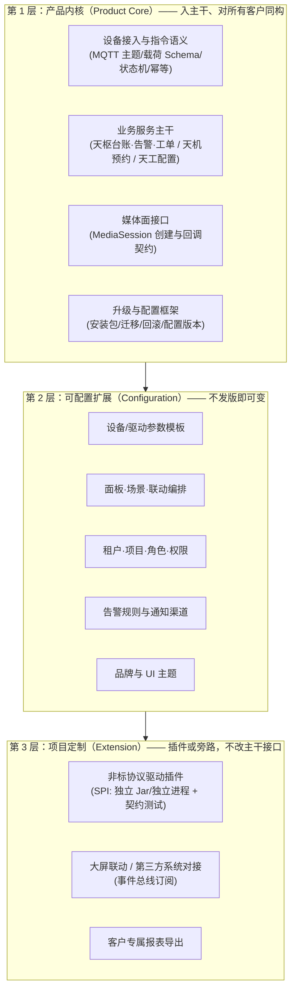

# 03 私有化交付 × 标准化产品：分层机制

> 这是本岗位的核心矛盾。我的立场一句话：**"定制"不是不能做，而是不能以"改主干代码"的形式做。**
> 定制必须被**降维**成配置、插件或旁路三种形态之一，否则我们卖出去的是项目而不是产品。

## 3.1 产品内核 / 可配置扩展 / 项目定制 三层

### 判定规则（**什么允许进主干，什么必须插件/配置/旁路**）

用**四问法**，任意一问命中"否"就不得进主干（评审时逐条打勾）：

1. **是否对 ≥2 个客户成立？** 只对一个客户成立 → 不得进主干（进插件/配置/旁路）。
2. **是否改变了主干对外接口（API/主题/事件/数据库表结构）？** 改变接口 → 不得进主干。
   （接口变更需要走架构评审 + 版本策略，不是"加个 if"能解决的）
3. **是否可以用"配置 + 数据"表达？** 能 → 必须是配置，不许写代码。
4. **是否需要改主干代码才能生效？** 需要 → 必须改成插件（SPI）或旁路（订阅事件）。

**反例与正解（用真实常见形态举例）**：

| 需求形态 | 错误做法 | 正解 | 归属层 |
|---------|---------|------|--------|
| 客户 A 的门禁要联动大屏 | 在 `AlarmService` 里加 `if (project == "A")` | 告警事件总线 + 客户自带的联动小程序订阅事件；或用天工的场景编排配置 | L3 旁路 / L2 配置 |
| 客户 B 的设备是私有协议 | 在接入网关加 `if (vendor == "B")` | 写 B 的协议驱动插件（实现 `VendorDriver` SPI），过契约测试后随交付包安装 | L3 插件 |
| 客户 C 要改首页大屏布局 | 复制一份前端页面 | 面板用模板 + 配置（布局 JSON / 主题变量） | L2 配置 |
| 客户 D 要不同的工单流程 | 复制一套工单服务 | 工单流程用轻量状态机 + 节点配置（**不引入工作流引擎**，见 `01` 不做清单） | L2 配置 |
| 客户 E 要开放 API 给其集团 | 在业务服务里直接暴露内部 Mapper | 提供稳定的开放 API（网关鉴权 + 限流 + 审计） | L1 内核（一次性建设，通用能力） |

### 三层的**版本与生命周期规则**（比分层本身更重要）

- L1 内核：**主干唯一分支**，客户环境不允许直接改内核代码；客户定制必须以 L2/L3 形式安装。
- L2 配置：**随产品版本走**，但每个配置项都要有"出厂默认值"，保证新装环境开箱可用（不用问客户要配置）。
- L3 插件：**有独立的版本号与兼容矩阵**（声明兼容的内核版本范围），内核大版本升级时插件必须重新认证。
  插件通过 SPI 契约（接口 + 契约测试用例）接入，**内核不引用插件实现**，只引用 SPI 接口。
  这条是"防止分叉毒死产品"的技术底线：**内核不能认识任何具体客户**。

## 3.2 标杆项目："非标协议设备 + 特殊大屏联动"，6 周交付

### 默认策略：**"主干不碰 + 三件并行"**

| 轨 | 内容 | 负责人 | 6 周内交付物 |
|----|------|--------|-------------|
| 轨 A（产品） | 把"非标协议接入"变成**产品能力**（VendorDriver SPI + 契约测试 + 驱动脚手架） | 架构师 + 嵌入式 | SPI 接口 + 脚手架 + 契约测试套件 + 1 个示例驱动（客户 B 的协议） |
| 轨 B（项目） | 客户 B 的协议驱动实现（基于轨 A 脚手架） | 嵌入式 1 人 | 驱动 Jar + 测试报告 + 联调环境 |
| 轨 C（项目） | 大屏联动用**事件订阅 + 编排配置**实现，不进内核 | 后端 1 人 + 客户方配合 | 事件契约文档 + 联动编排配置 + 客户大屏联调 |

### 时间盒与"防分叉"护栏

- **第 0 周（Day 1–3）：判定与冻结**
  - 逐条过 3.1 的四问法；命中"不得进主干"的全部转 L3。
  - **产出《变更影响说明》**：本次项目会新增哪些 SPI、哪些配置项、哪些事件；主干接口零变更 → 签字后冻结。
- **第 1–2 周**：驱动开发（轨 B）+ SPI 契约测试就位；平台侧用**模拟器**（假的 B 设备）跑通端到端，不等真机。
- **第 3–4 周**：真机联调；大屏联动用事件总线打通（客户大屏先跑 mock 事件）。
- **第 5 周**：灰度（仅该项目租户启用插件）+ 交付包固化（离线包、配置、插件、回滚脚本）。
- **第 6 周**：验收演练 + 运维手册 + **项目代码回流主干**（只回流 SPI 与脚手架，不回流客户配置）。

**三条硬护栏**：
1. **主干接口零变更**：项目期间主干如需改接口，必须走架构评审并计入下一版本，**不允许为单个项目插队**。
2. **插件化交付**：客户私有驱动与配置**不打进标准安装包**，作为项目附件独立安装/卸载，标准包保持"干净"。
3. **回流只回流机制**：项目结束必须回答"这次踩的坑，哪一步应该变成产品能力"（如"驱动脚手架缺少重连模板"），
   机制进主干、代码留在项目分支，避免把客户代码洗进内核。

**如果客户坚持要"我们自己的逻辑进你们的代码"**：答应，但以**付费的定制开发 + 明确的维护边界**承接，
并在合同中写明"该定制逻辑不随产品版本升级，需客户单独升级"——用商务手段而不是技术手段阻止分叉。

## 3.3 私有化升级：V3.2 → V3.5 的最低工程化能力

| 能力 | 最低要求 | 为什么是最低线 |
|------|---------|--------------|
| **版本化安装包** | 单一安装包（离线 tar/镜像）含版本清单（组件版本 + 校验和 + 依赖矩阵）；支持 `install --version` 与**并行安装两个版本**（蓝绿目录切换） | 没有版本清单，现场根本不知道装了什么；没有并行目录，回滚就是"祈祷" |
| **数据库迁移** | 所有 DDL/DML 迁移脚本**编号、幂等、可重复执行**，前向兼容（expand-contract 两步走：先加列兼容读，再切写，最后删旧列）；脚本进主干，**禁止手工改库** | 手工改库是"下次升级必炸"的头号来源；expand-contract 保证跨小版本滚动升级不出错 |
| **回滚** | 升级前自动备份（配置 + 数据库）；回滚 = 切回旧目录 + 回滚脚本；**明确"哪些数据不可回滚"**（如已删除的旧列）并在升级前提示 | 不回滚能力的升级 = 赌博。回滚必须是"一条命令 + 有明确的不可逆清单" |
| **配置版本化** | 配置（设备档案、面板、场景、联动）版本化存储，升级时做**配置迁移脚本**（同样编号幂等），并保留旧版本可回滚 | 客户现场改过的配置是"隐性资产"，丢了就是事故 |
| **插件兼容矩阵** | 每个插件声明兼容的内核版本范围；升级脚本**预检**插件兼容性，不兼容则**拒绝升级并给出处理建议**（升级/停用插件） | 私有化最常见的"升级失败"是插件不兼容 |
| **升级前检查（preflight）** | 自动检查：磁盘空间、时区/NTP、依赖服务版本、端口占用、数据库连接数、剩余连接数、插件兼容 | 现场升级失败 80% 是这些"低级问题"，检查脚本能挡掉大部分 |
| **可观测的升级过程** | 升级过程有日志与进度输出，失败自动停在安全点（不改数据的中断点） | 现场只有一次机会，操作员需要知道"到哪一步了" |
| **离线介质与校验** | 离线包带 SHA-256 校验；介质可在无网环境完成安装；**不依赖公网镜像** | 政企内网是常态 |
| **演练环境** | 提供"演示机/一体化沙箱"，售前与交付在**同一介质**上演练升级 | 每次升级都在客户现场裸奔是最大的交付风险 |

**升级 SOP（交付侧）**：备份 → preflight → 灰度一台 → 冒烟（设备上线/指令下发/预览三件事）→ 全量 → 观察 30 分钟 → 关闭回滚窗口。
**"三件事冒烟"**（上线、下发、预览）就是我们的最小可用性基线。

## 3.4 标准化率度量（4 个指标，谁看、别造假）

| 指标 | 定义 | 谁看 | 怎么用 | 防造假 |
|------|------|------|--------|
| **主干定制代码占比** | 客户项目在**主干仓库**中新增/修改的代码行数（按项目标签统计） / 主干总行数，按季度取样 | 研发负责人 + 我 | 目标：季度环比下降；把"主干定制代码占比 > 5%"设为发版门禁之一 | 用 **PR 标签 + CI 统计**自动出数，不靠人肉统计；定制代码必须打项目标签，未打标签的改动计入分母并触发评审 |
| **配置化覆盖率** | 交付给客户的功能点中，通过**配置/模板/插件**实现（而非改码实现）的比例 | 我 + 售前 | 作为 P1 结束时的验收指标（目标 ≥ 60%） | 统计口径固定为"售前功能清单 × 实现形态"逐项标注，抽样复核 |
| **SPI 契约测试通过率** | 插件（私有协议驱动）在契约测试套件上的通过率 | 嵌入式 + 我 | 上架前 100% 通过；不通过的插件不进入交付包 | 契约测试与插件同源发布，不允许项目自测替代 |
| **升级一次成功率 / 平均现场升级时长** | 现场升级中"一次成功且通过三件事冒烟"的比例；以及从开始到验收的时长 | 交付负责人 | 目标：一次成功率 ≥ 90%，时长中位数下降 | 数据从交付工单系统取（强制字段：是否回滚、是否二次进现场），**不依赖工程师自评** |

**明确反对的"假指标"**：不统计"标准化产品占比"这类用主观判断凑出来的数字；
不把"客户签署验收"当作标准化率证据。上面 4 个指标都能从**已有的自动化或工单系统**直接取数，
取不到的指标就不设（"设了但没人能取数"的指标只会变成 PPT 指标）。
